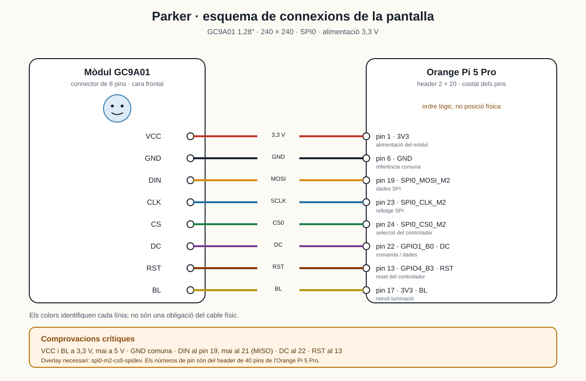
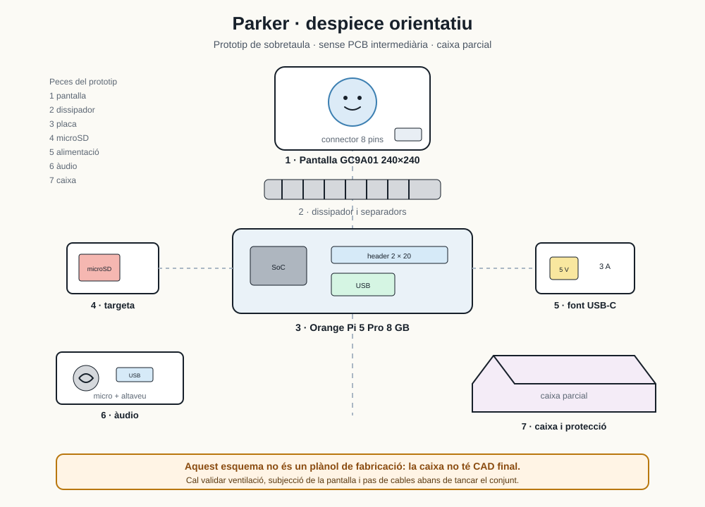

# 14 · Annex. Muntatge i esquemes electrònics

> **Aquest annex sí que és una guia tècnica.** La memòria explica per què es va
> prendre cada decisió; aquí es reuneixen el despiece, les connexions i l'ordre
> de muntatge que no tenen cabuda al cos del treball. No substitueix el manual
> del fabricant: el complementa amb el cablejat concret que es va fer servir.

[[TREC/03 Marc practic]] · [[TREC/08 Annex. Criteris de muntatge]] · [[TREC/15 Annex. Codi font complet]]

## 1. Abast i seguretat

Aquest annex cobreix el **maquinari del prototip**: Orange Pi 5 Pro, pantalla
GC9A01, micròfon, altaveu, alimentació, targeta microSD i caixa. No cobreix la
instal·lació del sistema operatiu ni les dependències de Python; això es tracta
a `docs/placa.md`.

Abans de tocar res:

- **Desconnecta l'alimentació** abans de moure qualsevol cable.
- Treballa sobre una superfície aïllant i sense pols.
- No connectis ni retiris cables amb la placa encesa.
- La pantalla i els senyals SPI treballen a **3,3 V**. No hi posis 5 V.
- Si has de soldar, fes-ho amb la placa desendollada i amb ventilació.
- No forcis el connector de la pantalla: els pins són petits i el mòdul no té
  una carcassa que protegeixi les pistes.

> **Avís de connexió.** El mòdul GC9A01 no es connecta per HDMI. Va per SPI i
> necessita una alimentació pròpia de 3,3 V, una terra comuna i els senyals de
> control DC i RST. Un cable mal posat pot deixar la pantalla en blanc o negra,
> encara que el programa sembli correcte.

## 2. Despiece

El prototip no té una placa PCB intermediària: la pantalla es connecta
directament al header de 40 pins de l'Orange Pi amb cables Dupont. Això fa el
muntatge més fàcil de modificar, però també més fràgil davant d'un cable fluix.

| Núm. | Peça | Quantitat | Funció | Observacions |
|---:|---|---:|---|---|
| 1 | **Orange Pi 5 Pro 8 GB** | 1 | Executa el sistema, el model local, la memòria i la interfície | RK3588S; 4×A76 + 4×A55 |
| 2 | **Pantalla GC9A01 1,28\"** | 1 | Mostra la cara de Parker | 240×240, circular, SPI, 3,3 V |
| 3 | **Targeta microSD 64 GB A2** | 1 | Sistema, models i records | Convé fer-ne còpia des del PC |
| 4 | **Font USB-C 5 V / 3 A** | 1 | Alimenta la placa i els perifèrics | Una font feble provoca talls i parpelleigs |
| 5 | **Micròfon USB** | 1 | Capta la veu | Pot trigar uns 29 s a enumerar-se |
| 6 | **Altaveu** | 1 | Reprodueix la veu | Jack o USB, segons el mòdul |
| 7 | **Dissipador** | 1 | Evita que el SoC baixi de freqüència per calor | Amb ventilació si la caixa és tancada |
| 8 | **Caixa** | 1 | Subjecta la pantalla i protegeix el conjunt | **Parcial**: no hi ha CAD final |
| 9 | **Cables Dupont femella-femella** | 8 | Connexions pantalla-placa | 20 cm aproximadament; color només per identificar |
| 10 | **Separadors i cargols** | 4 | Subjecten la placa | Material aïllant |

### 2.1 Què no forma part del despiece

- No hi ha **placa de distribució** ni PCB pròpia.
- No hi ha **càmera**, **rodes**, **braç** ni **sensors de proximitat**.
- No hi ha una **caixa definitiva** ni un model CAD del conjunt.
- No es venen ni es documenten com a peces del projecte els models de veu
  (`.onnx`), que es descarreguen a part.

La caixa és l'element menys acabat del prototip. A la memòria s'ha de presentar
com una **limitació de disseny**, no com una peça industrialitzada.

## 3. Esquema de connexions

La figura següent és un **esquema lògic**, no una foto a escala. Els colors
serveixen per seguir cada línia; no volen dir que el cable físic hagi de ser
d'aquell color.

*Figura 14.1. Connexions SPI/GPIO entre el mòdul GC9A01 i l'Orange Pi 5 Pro.
L'ordre dels terminals de la dreta és lògic; la posició física dels pins és la
de la taula següent.*

### 3.1 Taula de cablejat

| Mòdul | Senyal | Pin físic de la placa | GPIO / bus | Funció |
|---|---|---:|---|---|
| **VCC** | Alimentació 3,3 V | **1** o **17** | — | Alimenta el mòdul |
| **GND** | Terra | **6** | — | Referència comuna |
| **DIN** | Dades SPI | **19** | `SPI0_MOSI_M2` / GPIO1_B2 | Envia píxels i ordres |
| **CLK** | Rellotge SPI | **23** | `SPI0_CLK_M2` / GPIO1_B3 | Marca el ritme de les dades |
| **CS** | Chip select | **24** | `SPI0_CS0_M2` / GPIO1_B4 | Activa el controlador |
| **DC** | Comanda / dades | **22** | GPIO1_B0 / `gpiochip1` línia 8 | Distingeix ordre de píxel |
| **RST** | Reset | **13** | GPIO4_B3 / `gpiochip4` línia 11 | Reinicia el controlador |
| **BL** | Retroil·luminació | **17** | — | 3,3 V = brillantor fixa |

> **Pin 17.** VCC i BL no poden anar tots dos al mateix pin 17. Si VCC va a
> l'1, BL pot anar al 17; si VCC va al 17, BL ha d'anar a un altre 3,3 V. El
> més clar és **VCC a l'1 i BL al 17**.

### 3.2 Regles que no s'han de trencar

1. **VCC i BL a 3,3 V, mai a 5 V.** La placa té pins de 5 V al header; no són
   per a aquest mòdul.
2. **GND comuna.** La pantalla i la placa han de compartir terra.
3. **DIN al pin 19, no al 21.** El pin 21 és `MISO`, una entrada del SoC: no
   pot governar el mòdul. Moure el DIN al 21 deixa la pantalla negra.
4. **CS al pin 24.** Si el CS no està al lloc correcte, el controlador no rep
   les ordres.
5. **DC i RST no es poden intercanviar.** El driver els declara per nom a
   `config.yaml`; si es recablegen, cal canviar la configuració.
6. **Overlay SPI correcte.** Ha d'estar actiu `spi0-m2-cs0-spidev`. Un altre
   overlay de SPI0 pot enviar les dades a uns altres pins i deixar la pantalla
   en blanc.

### 3.3 Correspondència amb la configuració

El driver no cableja números de pin: llegeix noms de GPIO i resol el banc pel
label del kernel. Els valors de referència són:

| Paràmetre | Valor |
|---|---|
| `pantalla.spi_bus` | `0` → `/dev/spidev0.0` |
| `pantalla.spi_dispositivo` | `0` |
| `pantalla.velocidad_hz` | `24000000` |
| `pantalla.velocidad_init_hz` | `1000000` |
| `pantalla.dc_gpio` | `GPIO1_B0` (pin 22) |
| `pantalla.rst_gpio` | `GPIO4_B3` (pin 13) |
| `pantalla.modo_spi` | `0` |
| `pantalla.madctl` | `0x98` |
| `pantalla.inversion` | `true` |

La inicialització va a **1 MHz** perquè són escritures curtes amb canvis de
comanda i dades; els fotogrames grans van a **24 MHz**. No és una velocitat
arbitrària: primer s'assegura que el controlador entén les ordres i després
s'augmenta el bus.

## 4. Muntatge pas a pas

### Pas 0. Preparar el lloc

1. Desconnecta la font i la bateria si n'hi ha.
2. Descarga't l'electricitat estàtica tocant una superfície metàl·lica presa a
   terra.
3. Separa la placa, la pantalla, els cables i els cargols.
4. Comprova que el mòdul de pantalla és el **Waveshare 1.28inch LCD Module** o
   un equivalent amb controlador GC9A01 i connector de 8 pins.

### Pas 1. Fixar la placa i el dissipador

1. Col·loca els separadors aïllants als quatre forats de la placa.
2. Fixa el dissipador sobre el SoC sense forçar-lo.
3. Deixa espai perquè l'aire pugui sortir: la calor és el primer enemic del
   model local.
4. No collis la placa contra la caixa fins que hagis provat els cables.

### Pas 2. Preparar el cablejat de la pantalla

1. Identifica el **pin 1** del header: és el 3,3 V de l'extrem, amb la
   serigrafia al costat. Els pins imparells van per un costat i els parells per
   l'altre.
2. Prepara vuit cables Dupont i marca'ls amb etiquetes o colors:
   `VCC`, `GND`, `DIN`, `CLK`, `CS`, `DC`, `RST`, `BL`.
3. Connecta primer **GND** i després **VCC**; no a l'inrevés.
4. Connecta les línies SPI: `DIN` al 19, `CLK` al 23 i `CS` al 24.
5. Connecta `DC` al 22 i `RST` al 13.
6. Connecta `BL` al 17.
7. Revisa dues vegades que cap cable de 5 V arribi al mòdul.

> Els colors del diagrama són una ajuda visual. Si el teu mòdul porta una
> etiqueta o un connector diferent, **mana la serigrafia del mòdul**, no el
> color del cable.

### Pas 3. Fixar la pantalla

1. Presenta la pantalla a la caixa sense collar-la.
2. Deixa una mica de folgança al cable: si està tens, el moviment de la caixa
   pot arrencar el connector.
3. Subjecta el mòdul amb cargols o suports tous; no facis pressió sobre el
   vidre.
4. Comprova que la pantalla no toca cap component calent.

### Pas 4. Audio

1. Connecta el micròfon USB.
2. Connecta l'altaveu al jack o al USB, segons el model.
3. Separa el micròfon de l'altaveu per reduir acoblament i eco.
4. Recorda que el micròfon USB pot trigar uns **29 s** a aparèixer. Si el
   sistema obre l'àudio abans, pot quedar-se amb el dispositiu equivocat.

### Pas 5. Targeta i caixa

1. Grava la microSD amb la imatge del sistema.
2. Insereix-la fins que faci clic; no la forcis.
3. Tanca la caixa deixant una entrada d'aire i una sortida.
4. Deixa lliure la zona de l'antena Wi-Fi.
5. No tanquis amb els cables pinçats.

### Pas 6. Primera encesa

1. Connecta la font **5 V / 3 A**.
2. Espera que la placa arrenqui; no cal monitor si el sistema està en mode
   `offscreen`.
3. Espera l'aparició del micròfon i el xim d'audio.
4. Comprova que la cara apareix a la pantalla circular.
5. Si la pantalla és blanca, **no toquis el codi encara**: revisa BL, RST, DC,
   CS i la inicialització.
6. Si és negra, revisa l'alimentació i el cable DIN; no el moguis al pin 21.

### Pas 7. Abans de tancar

1. Fes una conversa curta i comprova so, transcripció i resposta.
2. Deixa el sistema 20 minuts en repòs i mira si la temperatura puja massa.
3. Comprova que no hi ha dues instàncies de Parker en marxa.
4. Apaga ordenadament i desconnecta la font abans de moure la caixa.
5. Fes una còpia de la targeta o dels records al PC.

## 5. Despiece i caixa

*Figura 14.2. Despiece orientatiu. La caixa és parcial i no hi ha un CAD final;
el diagrama serveix per explicar les peces, no per fabricar una carcassa.*

| Bloc | Estat | Comentari |
|---|---|---|
| Placa | Muntada | Orange Pi 5 Pro amb dissipador |
| Pantalla | Muntada | GC9A01 subjecta a la caixa |
| Àudio | Muntat | Micròfon USB i altaveu |
| Alimentació | Muntada | Font de 5 V / 3 A |
| Targeta | Muntada | microSD accessible sense desmuntar tot el conjunt |
| Caixa | **Parcial** | Protegeix, però no és un producte acabat |
| Cablejat | Directe | Sense PCB intermediària |

La caixa actual no s'ha de presentar com una solució definitiva. És un
prototip funcional: caldria un disseny CAD, una prova d'assemblatge i una
validació tèrmica abans de parlar d'un producte.

## 6. Verificació elèctrica i funcional

| Comprovació | Valor o resultat esperat | Senyal d'error |
|---|---|---|
| Alimentació del mòdul | 3,3 V entre VCC i GND | 5 V o 0 V |
| Terra | Continuïtat entre GND del mòdul i GND de la placa | Terra flotant |
| Retroil·luminació | BL a 3,3 V | Pantalla completament negra |
| SPI | `DIN` al 19, `CLK` al 23, `CS` al 24 | Blanc, negre o píxels esbiaixats |
| DC | Pin 22, `GPIO1_B0` | El controlador no distingeix ordres |
| RST | Pin 13, `GPIO4_B3` | La pantalla no s'inicialitza |
| Arrencada | Cara visible sense HDMI | Cap imatge |
| Àudio | Micròfon i altaveu disponibles | Silenci o dispositiu equivocat |
| Temperatura | Estable després de 20 minuts | Baixada de freqüència |
| Instància | Només un procés de Parker | Bus ocupat o cara congelada |

Aquestes comprovacions no són una llista de comandes: són les evidències que
cal tenir abans de dir que el muntatge funciona.

## 7. Errors típics de muntatge

| Símptoma | Causa probable | Què cal revisar |
|---|---|---|
| Pantalla blanca | BL alimentat, però el controlador no s'inicialitza | RST, DC, CS, overlay SPI i seqüència d'inici |
| Pantalla negra | Falta alimentació, GND o DIN mal connectat | VCC, GND i DIN al 19 |
| Pantalla amb colors estranys | MADCTL, inversió o ordre de bytes | `madctl: 0x98` i `inversion: true` |
| La cara es congela | Dues instàncies o bus saturat | Una sola instància; 15 fps |
| El micròfon no apareix | Enumeració USB tardana | Esperar, refrescar dispositius i xim |
| La placa es reinicia | Font insuficient | 5 V / 3 A i cable curt |
| Tot va lent | El SoC baixa freqüència per calor | Dissipador, ventilació i model local |
| Els ulls s'allarguen | Acumulació de moviment al motor | Tornar a la pose base |

## 8. Relació amb la memòria

- [[TREC/03 Marc practic]] §3.2 explica **per què** es va triar aquesta placa,
  aquesta pantalla i aquesta arquitectura.
- [[TREC/08 Annex. Criteris de muntatge]] recull **què es va verificar** i per
  què.
- Aquest annex recull **com es munta** i **com es connecta**.
- [[TREC/15 Annex. Codi font complet]] enllaça els scripts que fan funcionar el
  conjunt.

## 9. Traçabilitat

- Referència tècnica completa: `docs/placa.md` §7.
- Driver de pantalla: `modulos/display_spidev.py`.
- Configuració: `config.yaml` → `pantalla`.
- Repositori publicat: <https://github.com/PuntoMarcado/Parker>
- Data de revisió d'aquest annex: 5 de novembre de 2026.

> **Nota d'honestedat.** No s'ha fet una prova de consum amb instruments de
> laboratori ni una validació mecànica de la caixa. Les xifres de latència i
> temperatura són les del prototip, no les d'un producte fabricat en sèrie.
